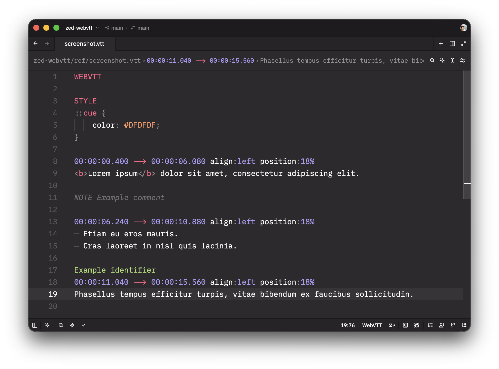

# WebVTT for Zed

[WebVTT](https://www.w3.org/TR/webvtt1/) (Web Video Text Tracks) support for
[Zed](https://zed.dev): subtitles, captions, chapters and metadata tracks in
`.vtt` and `.webvtt` files, including HLS subtitle segments.



<sub>Shown with the Zedokai Darker theme.</sub>

## Features

- **Syntax highlighting** for cues: timestamps, cue settings, identifiers,
  and cue text tags (`<b>`, `<i>`, `<u>`, `<c.class>`, `<v Speaker>`,
  `<lang>`, `<ruby>`), karaoke timestamps, entities and dialogue dashes
  (`–Hej.`). Also `NOTE` comments,
  `REGION` blocks and header metadata such as HLS's `X-TIMESTAMP-MAP`
- **Typos stand out**: cue settings, region settings, setting values and tag
  names that the specification doesn't define are shown as plain text, so
  `positon:18%`, `align:centre` or `<cc>` catch your eye
- **Built-in color classes** (`yellow`, `bg_blue`, …) are highlighted apart
  from your own classes, which need a `STYLE` rule
- **CSS in `STYLE` blocks**, highlighted by Zed's CSS support
- **Outline** (`cmd-shift-o`, the outline panel and breadcrumbs): each cue by
  its start and end time, with its lines of text nested below, without tags, so you
  can search the dialogue; `STYLE` with its `::cue` rules, and regions by id
- **Snippets**: `webvtt`, `cue`, `cue-settings`, `note`, `note-block`,
  `style`, `region`, `voice` and `class`
- **Language server**
  ([media-language-server](https://github.com/mlinder/media-language-server),
  installed from npm on first use): each cue's duration as an inlay hint,
  hover with the gap to the previous cue, and diagnostics for minutes or
  seconds over 59, cues out of order or ending before they start, timestamp
  tags outside their cue and `-->` in a `NOTE`

Based on [WebVTT: The Web Video Text Tracks Format](https://www.w3.org/TR/webvtt1/)
(W3C Candidate Recommendation Draft, 20 May 2026) and, for HLS subtitle
segments, section 3.1.4 of
[draft-pantos-hls-rfc8216bis-22](https://datatracker.ietf.org/doc/html/draft-pantos-hls-rfc8216bis-22#section-3.1.4)
(1 May 2026).
The grammar is [tree-sitter-webvtt](https://github.com/mlinder/tree-sitter-webvtt).

## Installation

Open the Extensions page (`zed: extensions`), search for **WebVTT** and click
**Install**. Files ending in `.vtt` or `.webvtt`, and other files whose first
line is `WEBVTT`, are recognized automatically. That covers subtitles served
as `text/vtt` and saved without an extension.

## Settings

For syntax highlighting only, turn the language server off. It is then never
downloaded; highlighting, outline and snippets don't need it:

```json
{
  "languages": {
    "WebVTT": { "language_servers": ["!webvtt-language-server", "..."] }
  }
}
```

## Known limitations

- Unbalanced tags aren't reported.
- Inlay hints are off by default in Zed: turn them on with
  `"inlay_hints": { "enabled": true }`.
- WebVTT has no line comments, so `cmd-/` does nothing. Use a `NOTE` block.
- Files with classic Mac line endings (a lone CR, without LF) aren't parsed
  correctly; CRLF and LF are.

## Development

Building the extension needs Rust installed with `rustup`; Zed adds the
`wasm32-wasip2` target itself. To run a local
[media-language-server](https://github.com/mlinder/media-language-server),
set `lsp.webvtt-language-server.binary` as its README describes.

1. Clone this repository and
   [tree-sitter-webvtt](https://github.com/mlinder/tree-sitter-webvtt).
2. To try local grammar changes, point `[grammars.webvtt]` in
   `extension.toml` at your checkout, e.g.
   `repository = "file:///path/to/tree-sitter-webvtt"`, and set `rev` to a
   commit that includes the regenerated `src/`. Delete this repository's
   `grammars/` folder whenever the repository URL changes.
3. In Zed, run `zed: install dev extension` and select this directory. After
   changing queries, snippets or `rev`, click **Rebuild** on the WebVTT
   extension in the Extensions page.

## License

[MIT](LICENSE)
